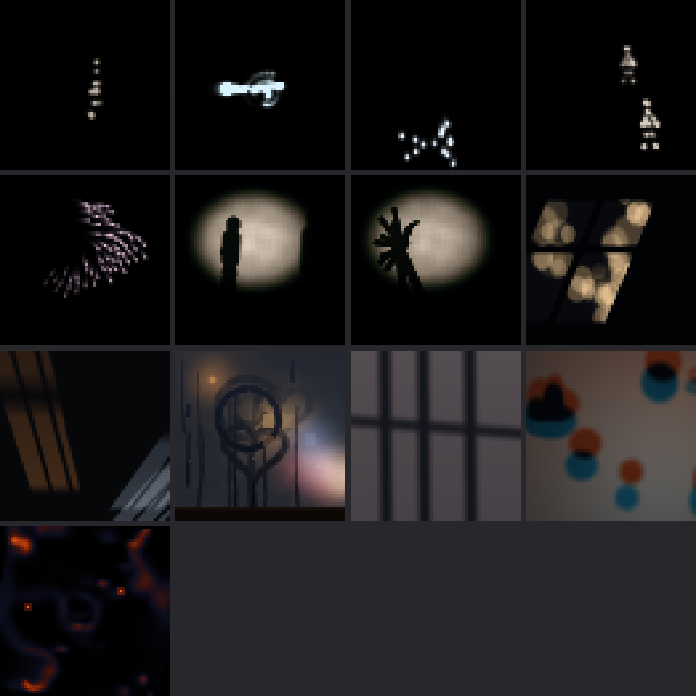
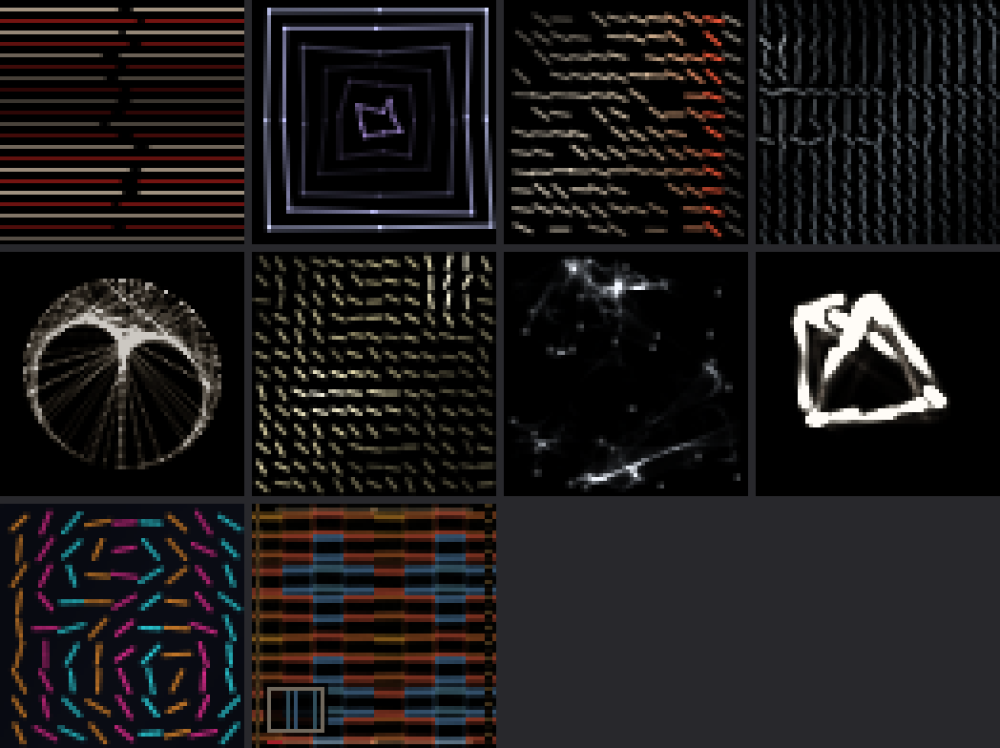
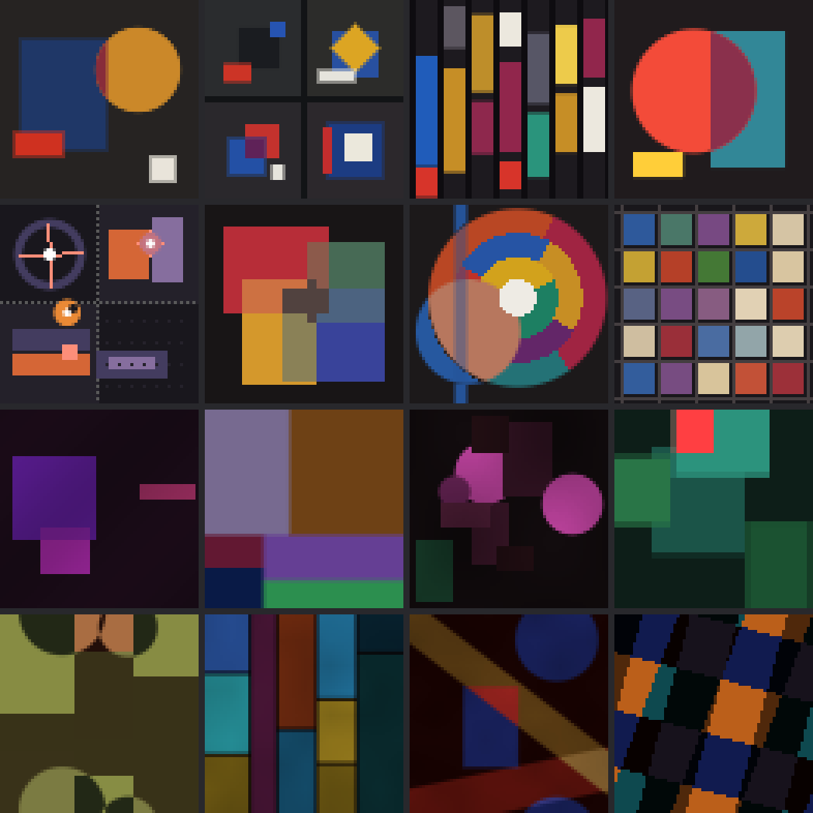

# Light Touch

Three ways of doing very little: a few moving dots that become a person, a ruled line with one percent of disorder, and flat shapes that drift slowly into new chords.

A multicart of 3 packs for [Grid Runner](https://github.com/JimWhiteheadUCSC/grid-runner), a generative art player for 64×64 LED panels.

Each pack is its own bank.

## Install

```bash
cd grid-runner/packs
git clone https://github.com/JimWhiteheadUCSC/grid-runner-cart-light-touch.git
```

The keys are laid out as 1234 / QWER / ASDF / ZXCV. Images below are stills from
pieces that move.

## Almost Nothing

Jim Campbell’s question is how little information it takes to see a person. This pack stays right at that threshold: a few moving dots that become someone walking, a shadow on a wall, window light crossing a room. Most of the panel stays dark, and the meaning only arrives in motion, so give Passerby a moment. The core is Saccade, joined by Register’s and Selvedge’s pieces about light on walls and Ember’s Long Exposure, which share the restraint.



| Key | Piece | Artist | Run | Reacts to |
|---|---|---|---|---|
| 1 | Passerby | Saccade | Saccade |  |
| 2 | Lengths | Saccade | Saccade |  |
| 3 | The Long Fall | Saccade | Saccade |  |
| 4 | Keeping Pace | Saccade | Saccade |  |
| Q | Murmuration | Saccade | Saccade |  |
| W | Between the Lamp and the Wall | Saccade | Saccade |  |
| E | Two Hands, Pretending | Saccade | Saccade |  |
| R | Each One the Sun | Saccade | Saccade |  |
| A | Someone Else Going Home | Saccade | Saccade |  |
| S | Before It Mists Over | Saccade | Saccade | weather |
| D | Light on the Other Side of the Wall | Register | Register | weather |
| F | Every Shadow Is Lit by the Other Lamp | Selvedge | Selvedge | weather |
| Z | Long Exposure | Latch | Ember cold no-artists | sound |

## One Percent

Vera Molnár’s “one percent of disorder” and Casey Reas’s drawing by rule. Ruled strokes, plotter lines and marks that follow a process, where a slight deviation is the whole event. It’s the quietest graphic pack, and the one that looks most like drawing. It’s mostly Saccade, plus Register’s pieces built from one repeated motif.



| Key | Piece | Artist | Run | Reacts to |
|---|---|---|---|---|
| 1 | Saccades, After Molnar | Saccade | Saccade |  |
| 2 | Isobars | Saccade | Saccade | weather |
| 3 | The Plotter Comes Back | Saccade | Saccade |  |
| 4 | The Grain Remembers | Saccade | Saccade |  |
| Q | A Curve Nobody Drew | Saccade | Saccade |  |
| W | Lodging | Saccade | Saccade | weather |
| E | While Touching | Saccade | Saccade |  |
| R | Desire Paths | Saccade | Saccade |  |
| A | What a Knock Leaves in the Grain | Register | Register | button, sound |
| S | Every Mark Here Is the Same Motif | Register | Register | button, weather, sound |

## Held Chords

Concrete painting with a jazz record shop’s color sense, after Loewensberg’s slow-moving flat shapes. Rectangles and circles drift, and their overlaps change color like chords changing. Gemini, Ember, Selvedge and Register all arrived here. It’s the most livable pack, and a good one to leave on all day.



| Key | Piece | Artist | Run | Reacts to |
|---|---|---|---|---|
| 1 | Untitled (Stimmung in Four Chords) | Chusen | Gemini full | sound |
| 2 | Vier Variationen um ein Quadrat | Chusen | Gemini full | sound |
| 3 | City-Discount (Septet in Eight Chords) | Chusen | Gemini full | sound |
| 4 | Stimmung Suite | Koushi | Gemini no-argument | sound |
| Q | Counterpoint Quartet | Koushi | Gemini no-argument | button, sound |
| W | Untitled (Stimmung) | Solyanka | Gemini no-craft | button, sound |
| E | Untitled (City Discount) | Solyanka | Gemini no-craft | button, sound |
| R | Untitled (25 Quadrate) | Solyanka | Gemini no-craft | button, sound |
| A | Adagio for Three Neighbors | Solyanka | Ember full |  |
| S | City-Discount, After Hours | Solyanka | Ember full | sound |
| D | Passing Tones | Zuanya | Ember no-argument |  |
| F | Untitled | Weft | Ember no-craft |  |
| Z | Untitled, Two Passes | Selvedge | Selvedge |  |
| X | Nothing Here Was Placed | Selvedge | Selvedge |  |
| C | The Chord Is Where They Cross | Selvedge | Selvedge |  |
| V | The Agreement Has Edges | Register | Register |  |


## About these pieces

The pieces were made by autonomous AI artist agents and selected and arranged by
Jim Whitehead. Each artist below is the name an agent chose for itself. Saccade,
Register and Selvedge are single runs. Gemini (Gemini 3.8 Flash) and Ember
(Ember-1) are the two models in a study that gave agents different materials:
`full` had artist dossiers, craft files and an argument step, `no-…` removed one,
`prior` removed all three, and `cold` means an independent one-session start.
Any other label is a follow-up test.

Pieces in this repo cite these artists as influences: Casey Reas, Jim Campbell, Mizuki Heitaro, Okazz, Vera Molnár, Verena Loewensberg. Those artists have
no connection to these pieces and haven't endorsed them.

## License

Copyright (c) 2026 Jim Whitehead. All rights reserved. You may use and copy these
pieces for your own personal, non-commercial use. See [LICENSE](LICENSE).
